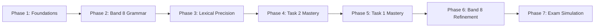

# IELTS Writing Band 8 Master Syllabus

This curriculum is structured into 7 progressive phases engineered to build authentic, independent Band 8 writing capabilities from foundational mechanics to high-pressure examination execution.

---

## Curriculum Overview

---

## Phase 1: Writing Foundations (Mechanics & Accuracy)
*Objective: Eliminate structural ambiguity, ensure complete sentences, and master foundational academic tone.*

1. **Understanding IELTS Writing Expectations**:
   - Marking system breakdown (Public Band Descriptors).
   - How examiners grade (TR/TA, CC, LR, GRA) and the penalty of rounding down.
2. **Sentence Architecture & Boundaries**:
   - Identifying and rectifying sentence fragments.
   - Eliminating comma splices and run-on sentences.
   - The distinction between simple, compound, and complex sentences.
3. **Core Grammatical Foundations**:
   - Subject-Verb Agreement (singular/plural traps, collective nouns, compound subjects).
   - Article mechanics (*a*, *an*, *the*, and zero article rules).
   - Preposition mastery (*in*, *on*, *at*, *by*, *for*, *since*).
   - Tense consistency and shifts in academic exposition.
4. **Paragraph Foundations**:
   - One central idea per paragraph (Paragraph Unity).
   - The Anatomy of a Topic Sentence.
   - Basic coherence devices and clear referencing.

---

## Phase 2: Grammar for Band 8 (Range, Flexibility & Control)
*Objective: Expand syntactical repertoire with high-precision complex structures without sacrificing accuracy.*

1. **Concessive and Contrast Clauses**:
   - Nuanced balance using *although*, *even though*, *whereas*, *while*.
   - Prepositional concession: *despite*, *in spite of*, *regardless of*.
2. **Conditional & Hypothetical Structures**:
   - Real vs unreal conditionals (First, Second, and Mixed Conditionals).
   - Inverted conditionals (*"Were governments to mandate..."*, *"Had policymakers anticipated..."*).
3. **Participle Clauses for Conciseness**:
   - Present participles (*-ing*) for expressing cause, effect, and simultaneous actions.
   - Past participles (*-ed*) for concise modifier placement.
4. **Relative & Noun Clauses**:
   - Non-defining relative clauses for parenthetical elaboration.
   - Nominalized subject clauses (*"What concerns environmentalists most is..."*).
5. **Academic Passives & Cleft Sentences**:
   - Strategic passive voice for objectivity (*"It is widely argued that..."*).
   - Cleft sentences for emphatic rhetorical focus (*"It is through targeted subsidies that..."*).
6. **Advanced Punctuation**:
   - Mastering the semicolon (`;`) for closely related clauses.
   - Using colons (`:`) and em-dashes (`—`) for explanatory emphasis.

---

## Phase 3: Lexical Development (Precision & Collocations)
*Objective: Build an active, topic-specific academic vocabulary focused on collocations, nuance, and natural idiom.*

1. **The Lexical Philosophy**:
   - Avoiding "thesaurus syndrome" (forced, archaic, or unnatural synonyms).
   - Collocation-first learning: strong verb-noun and adjective-noun pairings.
2. **Core IELTS Topic Clusters**:
   - **Education**: Pedagogical methodologies, holistic development, vocational training, socioeconomic barriers.
   - **Technology & AI**: Algorithmic automation, digital surveillance, ethical dilemmas, cyber resilience.
   - **Environment & Energy**: Carbon offsetting, biodiversity degradation, renewable integration, climatic volatility.
   - **Healthcare & Demographics**: Preventative vs curative medicine, demographic aging, healthcare subsidization.
   - **Government, Law & Society**: Civil liberties, judicial deterrence, punitive vs rehabilitative sentencing, fiscal stimulus.
   - **Urbanization & Globalization**: Infrastructure bottlenecks, cosmopolitan integration, cultural homogenization.
3. **Paraphrasing Mastery**:
   - Synonym replacement vs structural transposition (word form shifting).
   - Nominalization (converting verbs to nouns for academic density).

---

## Phase 4: Task 2 Mastery (Argumentation & Question Archetypes)
*Objective: Master every major IELTS Task 2 prompt type through cognitive mental models and rapid deconstruction.*

1. **Prompt Types & Examiners' Expectations**:
   - **Opinion (Agree / Disagree)**: Developing a nuanced, consistent stance.
   - **Discussion (Discuss Both Views and Give Your Opinion)**: Balanced objective evaluation + decisive personal thesis.
   - **Advantages vs Disadvantages**: Distinguishing between neutral listing and *"Do advantages outweigh disadvantages?"*.
   - **Problems & Solutions / Causes & Solutions**: Direct causal chains and pragmatic, policy-level interventions.
   - **Two-Part / Double Questions**: Answering both prongs with symmetrical depth.
2. **Brainstorming Architecture**:
   - 3-Minute Ideation using the C-R-E-I Engine.
   - Filtering weak ideas before writing.
3. **Essay Construction**:
   - The 4-minute Introduction Funnel (Paraphrase + Clear Position).
   - Body Paragraph Engineering: Topic Sentence -> Reason -> Explanation/Mechanism -> Impact/Example.
   - The Concise, Decisive Conclusion (Summary of key arguments + Final outlook).

---

## Phase 5: Task 1 Mastery (Data Synthesis & Reporting)
*Objective: Master concise, accurate data synthesis (Academic) or communicative purpose and tone (General Training).*

### Module A: Academic Task 1
1. **Overview Formulation (The Band 8 Linchpin)**:
   - Selecting 2–3 macro trends, contrasts, or anomalies without data dumping.
2. **Dynamic Data Charts**:
   - Line graphs & Trend reporting (fluctuation, plateau, sharp ascent, steady decline).
   - Bar charts & comparative language (proportions, multiples, disparities).
3. **Static Data & Proportions**:
   - Pie charts & Tables (dominant shares, negligible fractions, cross-category comparisons).
4. **Non-Data Diagrams**:
   - Process diagrams (passive voice, chronological transitions, sequential stages).
   - Maps & Spatial changes (compass directions, urban transformation, infrastructure additions).

### Module B: General Training Task 1
1. **Letter Types & Tone Calibration**:
   - Formal Letters (Official complaints, job applications, requests to authorities).
   - Semi-Formal Letters (Landlords, colleagues, service providers).
   - Informal Letters (Friends, relatives, personal invitations).
2. **Fulfilling the 3 Bullet Points**:
   - Balanced expansion across all three prompt prompts.
   - Purposeful opening and culturally appropriate sign-offs.

---

## Phase 6: Band 8 Writing Refinement (Precision, Polish & Style)
*Objective: Transition from competent (Band 7) to fluent, natural, and sophisticated (Band 8).*

1. **Band 7 vs Band 8 Nuance**:
   - Moving from mechanical cohesive markers to referential cohesion (demonstratives, lexical chains).
   - Eliminating vague generalities (*"some people"*, *"good things"*, *"in today's modern world"*).
2. **Sentence Rhythm & Cadence**:
   - Alternating short, impactful simple sentences with fluid compound-complex structures.
   - Academic hedging (*tends to*, *may potentially*, *is widely regarded as*).
3. **Advanced Proofreading Protocol**:
   - Targeted diagnostic scanning for high-frequency personal error patterns.

---

## Phase 7: Examination Simulation (Timed Under Pressure)
*Objective: Full timed examination readiness under strict 60-minute conditions.*

1. **Task Pacing Drill**:
   - Task 1: 20 minutes (3 min analysis, 14 min writing, 3 min proofreading).
   - Task 2: 40 minutes (5 min planning, 30 min writing, 5 min proofreading).
2. **Full Mock Assessments**:
   - Unannounced authentic prompts.
   - Full strict examiner evaluation and score tracking.
   - Verification against the Band 8 Readiness Framework.
