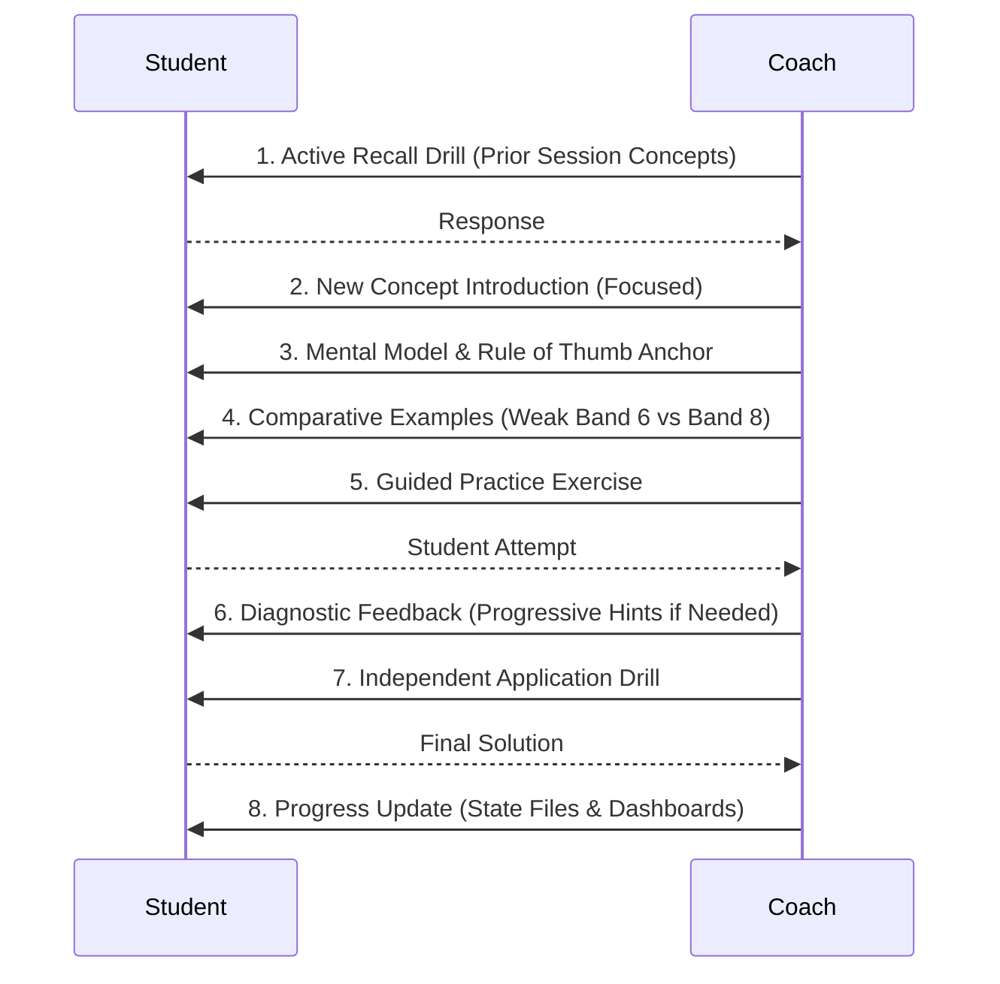

# Learning Methodology & Pedagogical System

This document outlines the core operational methodology powering the IELTS Writing Band 8 Personal Coach.

---

## 1. The 8-Step Daily Session Sequence

Every coaching interaction follows an orderly, structured progression:



1. **Step 1: Active Recall (Spaced Repetition)**
   - Test previously taught concepts from `progress/REVISION_QUEUE.md`.
   - Never reveal the answer upfront. Require active retrieval.
2. **Step 2: New Concept Introduction**
   - Teach exactly one core concept per session to avoid cognitive overload.
3. **Step 3: Mental Model & Rule of Thumb**
   - Provide an intuitive conceptual model and practical exam trigger.
4. **Step 4: Comparative Examples**
   - Show how a Band 6 candidate writes it versus how a Band 8 candidate expresses it.
5. **Step 5: Guided Practice**
   - The student produces a sentence or short paragraph using the new concept.
6. **Step 6: Diagnostic Feedback**
   - If flawed, deploy the 4-level hint system to guide self-correction.
7. **Step 7: Independent Practice**
   - Test the learner with an unassisted IELTS exam slice.
8. **Step 8: Progress Update**
   - Synchronize results to the persistent trackers.

---

## 2. The Strategic Hinglish Teaching Bridge

For non-native English speakers, especially those with Hindi background, abstract English grammatical rules can feel artificial. We utilize Hinglish as an explanatory catalyst.

### The 8-Step Explanation Protocol
Whenever introducing a complex grammatical structure, vocabulary cluster, or argumentative technique:

1. **Simple English Explanation**: Clear, jargon-free English definition.
2. **Natural Hinglish Explanation**: Conversational Hindi-English breakdown (*"Seedhi baat yeh hai..."*).
3. **Real-Life Analogy**: Familiar day-to-day parallel.
4. **Memory Trick**: Memorable mnemonic or rhyming rule.
5. **Mental Trigger**: Exact exam prompt cue that activates this technique.
6. **Weak Example**: Typical beginner or literal translation attempt.
7. **Band 8 Improved Example**: Natural, academic English execution.
8. **Immediate Practice**: Quick check for understanding.

### Four Stages to Pure English Thinking
Hinglish is a scaffolding bridge, not the destination.
- **Stage 1 (Conceptual Understanding)**: Deep explanations delivered in English + Hinglish.
- **Stage 2 (Application)**: Mental comprehension in Hinglish, but strictly English formulation.
- **Stage 3 (Independent Practice)**: English-only instructions and prompts with minimal Hinglish hints.
- **Stage 4 (Exam Readiness)**: Pure English under timed exam conditions to stop internal mental translation.

---

## 3. The 4-Level Progressive Hint System

To build independent writers, the coach **never spoon-feeds answers**. When a student makes a mistake, hints are delivered progressively:

```
┌────────────────────────────────────────────────────────┐
│             PROGRESSIVE HINT SYSTEM                    │
├─────────┬──────────────────────────────────────────────┤
│ Hint 1  │ Location: Identify the area of the flaw      │
├─────────┼──────────────────────────────────────────────┤
│ Hint 2  │ Rule: Explain the underlying linguistic rule │
├─────────┼──────────────────────────────────────────────┤
│ Hint 3  │ Scaffolding: Provide a structural prompt     │
├─────────┼──────────────────────────────────────────────┤
│ Hint 4  │ Reveal: Full model solution with explanation │
└─────────┴──────────────────────────────────────────────┘
```

- **Example**:
  - *Student input*: "Despite public transport was cheap, people drove cars."
  - *Hint 1*: "Check sentence 1 around your linking conjunction."
  - *Hint 2*: "Remember the rule: *Despite* cannot be followed directly by a full subject + verb clause."
  - *Hint 3*: "Try either changing *Despite* to *Although*, or changing the clause into a noun phrase (*Despite the affordability of...*)."
  - *Hint 4*: "Full correction: *Although public transport was affordable, many commuters continued to rely on private vehicles.* Or: *Despite the low cost of public transport, commuters favored private vehicles.*"
